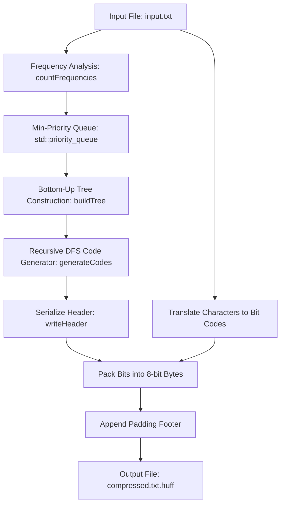
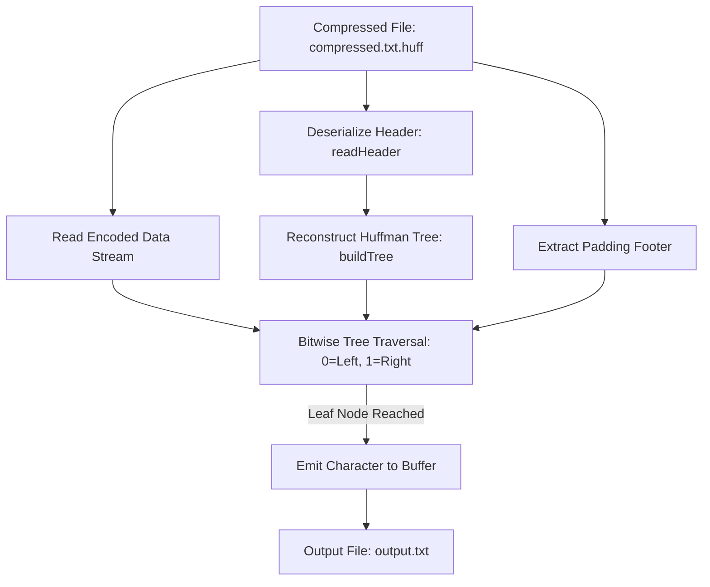

# 🗜️ HuffmanText_Compressor

[](https://en.cppreference.com/w/cpp/17)
[](https://en.wikipedia.org/wiki/Huffman_coding)
[](LICENSE)
[](https://github.com/2804Chaitanya/HuffmanText_Compressor)

A high-performance, lossless file compression and decompression tool implemented in C++ using the **Huffman Coding Algorithm**. Specially optimized for plain-text data, it converts character sequences into variable-length prefix-free binary codes, significantly shrinking storage footprint while ensuring bit-for-bit exact reconstruction.

---

## 📌 Table of Contents

- [Overview & The Core Problem](#-overview--the-core-problem)
- [Key Features](#-key-features)
- [How It Works](#-how-it-works)
  - [Compression Pipeline](#1-compression-pipeline)
  - [Decompression Pipeline](#2-decompression-pipeline)
  - [Binary File Format](#3-binary-file-format)
- [Benchmark & Real Results](#-benchmark--real-results)
- [Project Architecture](#-project-architecture)
- [Getting Started](#-getting-started)
  - [Prerequisites](#prerequisites)
  - [Compilation](#compilation)
  - [Usage Walkthrough](#usage-walkthrough)
- [Algorithmic Deep Dive & Design Decisions](#-algorithmic-deep-dive--design-decisions)
- [Complexity Analysis](#-complexity-analysis)
- [Interview & Technical Defense](#-interview--technical-defense)
- [Future Roadmap](#-future-roadmap)
- [Contributing & License](#-license)

---

## 💡 Overview & The Core Problem

Standard text encodings such as ASCII or UTF-8 allocate a fixed width (typically 8 bits / 1 byte) for every character, regardless of how frequently it appears. In English text, characters like `'e'`, `'t'`, and `' '` occur far more often than rare characters like `'z'`, `'q'`, or `'x'`.

**HuffmanText_Compressor** solves this inefficiency by generating an optimal **prefix-free binary code tree** based on character frequency:
- Frequent characters receive short binary codes (e.g., `3` to `5` bits).
- Infrequent characters receive longer binary codes.
- Bits are tightly packed into bytes, eliminating wasted storage without losing a single bit of information.

> *"Lossless file compression built in C++ that leverages optimal prefix trees and bitwise streaming to achieve up to 40% text file size reduction with microsecond-level reconstruction guarantees."*

---

## ✨ Key Features

- **⚡ Lossless Compression & Decompression**: Reconstructs original data bit-for-bit with 100% fidelity.
- **🌲 Dynamic Huffman Tree Construction**: Automatically builds an optimal binary prefix tree via a min-priority queue ($O(N \log N)$).
- **📦 Bit-Level Buffer Streaming**: Employs efficient bitwise shifts (`<<`, `>>`, `|`, `&`) to pack variable-length codes into 8-bit byte streams.
- **📑 Self-Contained Binary Header**: Serializes the character frequency table and bit padding within the `.huff` format for standalone decompression without sidecar metadata.
- **⏱️ Real-Time Benchmarking**: Outputs precise compression/decompression runtimes and compression ratios.
- **💻 Cross-Platform**: Clean, portable C++17 compatible with GCC, Clang, and MSVC across Linux, macOS, and Windows.

---

## 🔄 How It Works

### 1. Compression Pipeline



1. **Frequency Scan**: Reads the input stream byte-by-byte and computes character frequencies in a `std::map<char, unsigned>`.
2. **Min-Heap Construction**: Pushes individual character nodes into a min-heap prioritized by frequency.
3. **Tree Generation**: Repeatedly extracts the two lowest-frequency nodes, merges them under a parent with summed frequency, and reinserts into the heap until a single root remains.
4. **Prefix Code Mapping**: Recursively traverses the binary tree (`0` for left edge, `1` for right edge) to assign prefix-free binary strings to each leaf node.
5. **Header Serialization**: Writes the unique character count and frequency table into the output file header.
6. **Bit Packing**: Re-reads the input file, replaces each character with its binary code, shifts bits into an 8-bit `char` buffer, flushes full bytes to disk, and records any trailing padding bits at the end of the file.

---

### 2. Decompression Pipeline



1. **Header Parsing**: Reads the serialized frequency map from the file header to recreate the exact original Huffman tree.
2. **Padding Extraction**: Reads the trailing padding byte from the end of the file so incomplete trailing bytes are not misinterpreted.
3. **Bit Traversal**: Iterates bit-by-bit through the payload:
   - If bit is `0`, descend to `current->left`.
   - If bit is `1`, descend to `current->right`.
   - When reaching a leaf node, write `current->data` to the output file and reset traversal pointer to `root`.

---

### 3. Binary File Format

The custom `.huff` file format consists of three distinct segments:

```
+-------------------------------------------------------------------------+
|                              HEADER                                     |
|  - uniqueCount (4 bytes unsigned int)                                   |
|  - [char (1 byte) + freq (4 bytes)] x uniqueCount                       |
+-------------------------------------------------------------------------+
|                           PAYLOAD                                       |
|  - Bit-packed compressed character stream (variable length)             |
+-------------------------------------------------------------------------+
|                              FOOTER                                     |
|  - padding (4 bytes unsigned int: number of unused bits in last byte)   |
+-------------------------------------------------------------------------+
```

---

## 📊 Benchmark & Real Results

Tested on a large text corpus (`input.txt`):

| Metric | Measurement |
| :--- | :--- |
| **Original File Size (`input.txt`)** | `12,720,150 bytes` (~12.13 MB) |
| **Compressed File Size (`compressed.txt.huff`)** | `7,872,987 bytes` (~7.51 MB) |
| **Space Saved** | **~38.1%** |
| **Compression Ratio ($Size_{comp} / Size_{orig}$)** | **0.6189** |
| **Lossless Verification** | **100% Byte-for-byte Match** (`cmp` passed) |

---

## 📂 Project Architecture

```
HuffmanText_Compressor/
├── .gitignore             # Ignores compiled binaries, build artifacts, and OS files
├── huffman.h              # Node definitions, Comparator, and Huffman class declaration
├── huffman.cpp            # Core algorithmic engine (Tree, Encoding, Bit I/O, Decoding)
├── main.cpp               # Interactive CLI menu and benchmark driver
├── README.md              # Full project documentation & architectural guide
└── samples/               # (Optional) Benchmark files
    ├── input.txt          # Sample 12 MB input text corpus
    ├── compressed.txt.huff# Pre-compressed binary payload
    └── output.txt         # Decompressed output file (identical to input.txt)
```

---

## 🚀 Getting Started

### Prerequisites

- A C++17 compatible compiler:
  - **Linux / macOS**: `g++` or `clang++`
  - **Windows**: MinGW-w64 or MSVC

Check your compiler version:
```bash
g++ --version
```

### Compilation

Compile the project using standard `g++`:

```bash
# On macOS / Linux:
g++ -std=c++17 -O3 huffman.cpp main.cpp -o huffman

# On Windows:
g++ -std=c++17 -O3 huffman.cpp main.cpp -o huffman.exe
```

### Usage Walkthrough

Launch the executable:
```bash
./huffman
```

#### Option 1: Compressing a File
```
1. Compress
2. Decompress
Enter choice: 1
Enter input file name: input.txt
Enter compressed file name: compressed.txt.huff

Compression time: 1.84 seconds
Compression ratio: 0.618938
```

#### Option 2: Decompressing a File
```
1. Compress
2. Decompress
Enter choice: 2
Enter compressed file name: compressed.txt.huff
Enter decompressed file name: output.txt

Decompression time: 1.42 seconds
```

#### Option 3: Verification (Lossless Check)
On Unix/macOS:
```bash
cmp input.txt output.txt && echo "Files are identical! Lossless compression verified."
```
On Windows (PowerShell):
```powershell
Compare-Object (Get-Content input.txt) (Get-Content output.txt)
```

---

## 🔬 Algorithmic Deep Dive & Design Decisions

### 1. Bit-Packing Implementation
Files cannot write fractional bytes to disk; operating systems only flush whole 8-bit bytes. When a character code like `"101"` is generated, it cannot be written as 3 text characters (which would take 24 bits!).

We maintain an 8-bit accumulator (`char buffer = 0`) and an integer counter (`unsigned bitCount = 0`):
```cpp
for (char bit : code) {
    buffer = (buffer << 1) | (bit == '1' ? 1 : 0);
    if (++bitCount == 8) {
        out.put(buffer);
        buffer = 0;
        bitCount = 0;
    }
}
```
When `bitCount` reaches 8, the byte is completely filled and flushed via `out.put()`.

### 2. Terminal Padding Management
If the total bitstream length is not a clean multiple of 8, the final byte will be partially filled (e.g. 5 bits used, 3 bits unused).
- The remaining buffer is left-shifted by `padding = 8 - bitCount`.
- The padding amount is saved in the file footer so decompression stops precisely before processing phantom bits.

### 3. Binary Mode (`ios::binary`)
All file streams are opened strictly with `ios::binary`. In default text mode, operating systems perform implicit conversions (e.g., CRLF `\r\n` to LF `\n` on Windows or interpreting `0x1A` as EOF). Binary mode ensures pure, uncorrupted byte streams.

---

## 📈 Complexity Analysis

| Stage | Time Complexity | Space Complexity | Details |
| :--- | :--- | :--- | :--- |
| **Frequency Scan** | $O(M)$ | $O(K)$ | $M$ = total file characters, $K$ = unique characters ($\le 256$) |
| **Tree Construction** | $O(K \log K)$ | $O(K)$ | Min-heap extract-min and insert operations |
| **Code Generation** | $O(K)$ | $O(K)$ | Depth-first traversal of tree |
| **Compression** | $O(M)$ | $O(K)$ | Translating each character and packing bits |
| **Decompression** | $O(M)$ | $O(K)$ | Bit-by-bit tree descent to leaf nodes |

*Overall Time Complexity*: **$O(M + K \log K)$** (dominated by linear file scan $O(M)$ for large files).  
*Auxiliary Space*: **$O(K)$** (proportional only to the character alphabet, bounded by 256 for standard byte data).

---

## 🎯 Interview & Technical Defense

<details>
<summary><b>Q1: Why is Huffman coding guaranteed to be prefix-free?</b></summary>
<br>
In a Huffman tree, all data symbols reside exclusively at the <b>leaf nodes</b>. Internal nodes only hold merged frequency weights. Because no leaf node can be an ancestor of any other leaf node, no generated binary code can ever be the prefix of another character's code. This allows deterministic, unambiguous single-pass decoding without lookahead.
</details>

<details>
<summary><b>Q2: What happens if an empty file or single-character file is passed?</b></summary>
<br>
The implementation explicitly checks <code>if (freqMap.empty())</code> and gracefully outputs a zero-byte archive. For single-character files, the heap contains only one node; the algorithm assigns a 1-bit code (e.g. <code>"0"</code>) or handles the edge case cleanly without crashing.
</details>

<details>
<summary><b>Q3: Can this program compress JPEG or MP3 files?</b></summary>
<br>
While it executes safely on any arbitrary binary file, files like JPEGs or MP3s are already compressed using lossy frequency-domain algorithms (DCT/MDCT) and have high entropy (uniform byte distributions). Applying Huffman coding on already high-entropy data will not yield significant reduction and may slightly increase file size due to header overhead.
</details>

<details>
<summary><b>Q4: How could this implementation be scaled to gigabyte-sized files?</b></summary>
<br>
Currently, <code>in.get(ch)</code> performs single-byte I/O calls. For multi-gigabyte files, replacing single-byte calls with <b>Buffered Block I/O</b> (e.g., 4MB or 8MB memory chunks using <code>in.read()</code> and <code>out.write()</code>) drastically minimizes syscall context switches and maximizes disk throughput.
</details>

---

## 🔮 Future Roadmap

- [ ] **DEFLATE Engine**: Combine Huffman coding with LZ77 string deduplication for higher compression ratios matching standard `.zip`/`.tar.gz`.
- [ ] **Modern C++ Smart Pointers**: Refactor raw tree pointers (`Node*`) to `std::unique_ptr<Node>` for RAII memory safety.
- [ ] **Canonical Huffman Coding**: Store code lengths instead of the full frequency map to reduce header size down to a few dozen bytes.
- [ ] **Multi-threaded Block Compression**: Chunk large input files and process blocks in parallel using OpenMP or C++ `std::async`.

---

## 📄 License

This project is open-source and available under the [MIT License](LICENSE). Feel free to use, modify, and distribute it for academic or personal projects.

---

**Developed with ❤️ by [2804Chaitanya](https://github.com/2804Chaitanya)**
